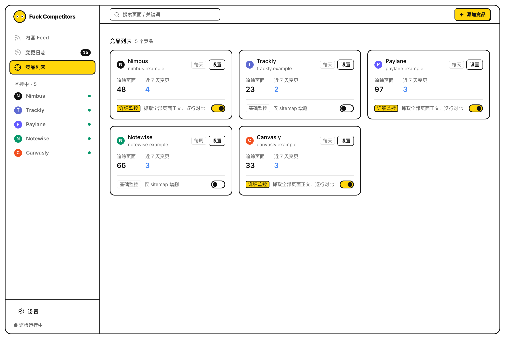
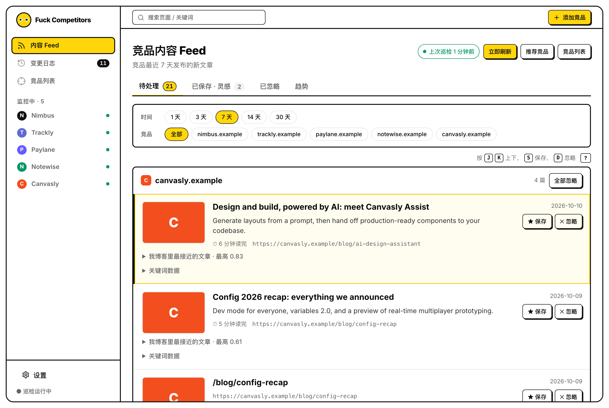
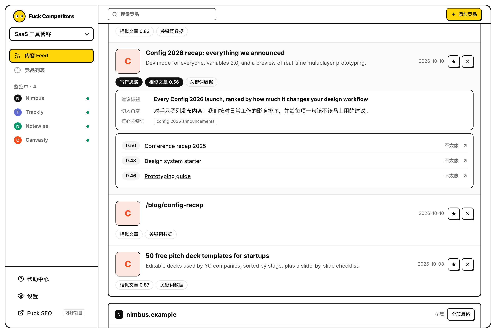
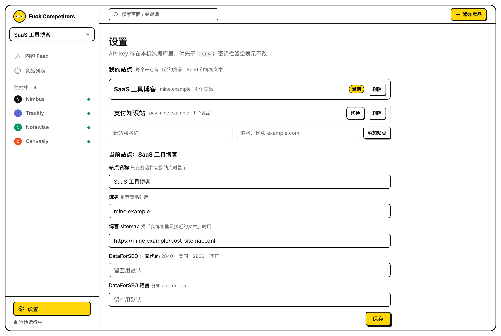

<div align="center">

# Fuck Competitors

**盯住对手新发的内容，找到你下一篇该写什么。**

[](https://github.com/tod-zhang/fuck-competitors/actions/workflows/ci.yml)
[](LICENSE)
[](https://www.python.org/)
[](Dockerfile)

一个开源、可自行部署的竞品内容监控工具。填入对手的 `sitemap.xml`，它每月巡检一次，
把对手**新发布的文章**排进内容 Feed，配上你博客里最接近的文章、AI 写作思路和关键词数据。

**[👀 在线演示 → competitors.fuckseo.io](https://competitors.fuckseo.io)**（示例数据，只读）

姊妹项目：**[Fuck SEO](https://fuckseo.io)** —— 免费的 Google Search Console 数据分析工具。竞品监控看对手，Fuck SEO 看自己。

</div>

| 全部站点 | 内容 Feed |
| --- | --- |
|  |  |
| **写作思路与相似文章** | **设置** |
|  |  |

---

## 它能做什么

- 📰 **内容 Feed**：对手最近 30 天新发的文章，按竞品分组排成收件箱。★ 保存值得写的（顺手记一句笔记），✕ 忽略不相关的。
- ≈ **相似文章**：同步你自己博客的 sitemap，给每篇对手文章找出你博客里最接近的 3 篇。0.8 以上说明你多半已经写过。
- ✍️ **写作思路**：对你还没写过的话题（最接近的一篇相似度低于 0.6），巡检后自动用大模型生成建议标题、切入角度和核心关键词，保存时带进笔记。
- 🔑 **关键词数据**：按需从 DataForSEO 拉这篇文章已经排名的词，以及核心词的搜索量、难度和相关词。
- 📈 **趋势**：每个竞品一份 30 天内容策略解读：在押什么方向、反复出现的主题、你可以跟进的选题。
- 🧭 **推荐竞品**：按你的域名找出和你抢同一批关键词的网站，一键关注并自动找它的 sitemap；不感兴趣的可以排除。
- 🗂️ **多站点**：运营好几个不同品类的站？每个站点有自己的竞品、Feed 和博客，首页一张卡片一个站点。
- 🤖 **MCP**：把数据开放给 Claude Code、Cursor 等 AI 客户端，直接问「这个月对手发了哪些我还没写过的？」。
- 🐳 **好部署**：一个 Docker 容器加一个 SQLite 文件，不依赖任何外部服务；没有前端构建步骤。

## 快速开始

```bash
git clone https://github.com/tod-zhang/fuck-competitors.git
cd fuck-competitors
docker compose up -d
# 打开 http://localhost:9527
```

然后：

1. 在首页「全部站点」添加你的站点（名称和域名）。
2. 进入站点，在「设置 → 站点信息」填上你博客的 sitemap，点「同步我的博客」。
3. 右上角「添加竞品」填对手的 sitemap，或者点「推荐竞品」让它按你的域名找。
4. 在「设置」里填 API Key（见下文），相似文章、写作思路、关键词和趋势才会开启。
5. 之后每个月打开「内容 Feed」看一遍。

应用里左下角的「帮助中心」有每个功能的详细说明。

## 工作方式

- **巡检**：每个竞品每月一次，只下载它的 sitemap 和上次对比，找出新上线的页面；分类页、标签页、作者页、图片这类网址会被过滤掉。新文章会单独抓一次，取标题、摘要、缩略图和正文开头。想马上查，点 Feed 右上角「立即刷新」。
- **第一次巡检**只记下对手现有的页面，不会把旧文章当新文章刷屏；不过最近 30 天内更新过的文章会放进 Feed，免得一开始是空的。
- **相似度**：把对手文章和你博客文章的「标题 + 正文开头约 6000 字」做向量，算余弦相似度，只在同一个站点里比较。
- 抓取时遵守 robots.txt、限制同一域名的请求间隔，遇到 403 / 429 会自动退避。

## API Key

所有 AI 和数据功能都是可选的，各自填了 Key 才开启。在应用的「设置」里填（存在本机数据库里，优先于 `.env`，每项都有「测试连接」），也可以写进 `.env`（见 `.env.example`）。API Key 所有站点共用。

| 服务 | 用来做什么 | 说明 |
| --- | --- | --- |
| **DataForSEO** | 推荐竞品、关键词数据 | 按次计费。推荐结果会缓存，关键词只在你点按钮时才查。每个站点可以单独设国家和语言。 |
| **嵌入接口** | 相似文章 | 任意 OpenAI 格式的 `/embeddings` 接口，默认 OpenRouter 上的 `qwen/qwen3-embedding-8b`。 |
| **大模型** | 写作思路、趋势 | 任意 OpenAI 格式的 `/chat/completions` 接口（默认 DeepSeek），或者 Claude 官方 API（默认 `claude-opus-5-5`）。 |

## MCP（给 AI 用）

应用自己就在 **`/mcp`** 上提供 MCP 服务：你用什么地址打开网站，MCP 就是那个地址加 `/mcp`（例如本机是 `http://localhost:9527/mcp`）。打开「设置 → MCP」可以生成访问令牌，并直接复制 Claude Code 命令或 `mcp.json` 配置。

| 工具 | 作用 |
| --- | --- |
| `list_sites` | 你的站点，以及每个站点监控的竞品 |
| `get_feed` | 最近的新文章：相似文章、写作思路、关键词数据、你的笔记和保存状态（可按站点、状态、竞品过滤） |
| `get_trends` | 每个竞品的 30 天内容策略解读 |
| `list_competitors` | 监控中的竞品（可按站点过滤） |
| `get_changes` / `get_page_history` / `summarize_window` / `get_diff` | 原始的页面增删记录 |

接上之后可以这样问：

```
这个月对手发了哪些我还没写过的文章？按写作思路排个优先级。
看一下 Nimbus 最近 30 天的内容策略，我能跟进哪些选题？
```

所有工具都是只读的。只在自己电脑上用可以不设令牌；**能从公网访问到时，务必生成令牌**（或设置环境变量 `FC_MCP_TOKEN`）。

不想开服务的话，也可以让客户端直接以 stdio 方式启动它，在项目根目录建 `.mcp.json`：

```json
{
  "mcpServers": {
    "fuck-competitors": {
      "command": ".venv/bin/python",
      "args": ["-m", "app.mcp_server"],
      "env": { "FC_DB_URL": "sqlite:///./data/app.db" }
    }
  }
}
```

## 部署

### Docker（推荐）

```bash
docker compose up -d     # 应用在 :9527；另有一个独立的 MCP 服务在 :9528（可选）
```

数据库是主机上的 `./data/app.db`。它是目录挂载，不是 Docker 命名卷，所以重建镜像、`docker compose down -v` 都不会动它。备份就复制这个文件；想从头开始，删掉 `./data` 再启动。

仓库带了一个 `Makefile`（固定项目名，并用经典构建器，项目放在中文路径下也能构建）：

```bash
make up      # 构建并后台启动
make logs    # 看日志
make down    # 停止（保留 ./data）
```

部署到公网时，用 nginx / Caddy 之类在前面加 HTTPS，并记得给 MCP 设令牌。

### 源码运行

```bash
python3 -m venv .venv && . .venv/bin/activate
pip install -r requirements.txt
uvicorn app.main:app --port 9527
```

> ⚠️ 定时巡检跑在进程内，请只开**一个 worker**（默认就是），否则会重复巡检。

## 配置

所有配置都是 `FC_` 开头的环境变量，常用的如下（完整列表见 `.env.example` 和 `app/config.py`）：

| 变量 | 默认值 | 含义 |
| --- | --- | --- |
| `FC_DB_URL` | `sqlite:///./data/app.db` | 数据库位置 |
| `FC_DEFAULT_INTERVAL_HOURS` | `720` | 所有竞品的巡检间隔（小时，默认 30 天） |
| `FC_MCP_TOKEN` | 空 | MCP 访问令牌（「设置」里填的优先） |
| `FC_RESPECT_ROBOTS` | `true` | 是否遵守对手站点的 robots.txt |
| `FC_CRAWL_DELAY_SECONDS` | `1.0` | 同一域名两次请求的最小间隔 |
| `FC_REQUEST_TIMEOUT` | `20` | 单次请求超时（秒） |
| `FC_DATAFORSEO_LOGIN` / `FC_DATAFORSEO_PASSWORD` | 空 | DataForSEO 账号 |
| `FC_EMBEDDING_BASE_URL` / `FC_EMBEDDING_API_KEY` / `FC_EMBEDDING_MODEL` | OpenRouter / 空 / `qwen/qwen3-embedding-8b` | 嵌入接口 |
| `FC_LLM_PROVIDER` | `openai` | `openai`（任意 OpenAI 格式）或 `anthropic`（Claude 官方 API） |
| `FC_LLM_BASE_URL` / `FC_LLM_API_KEY` / `FC_LLM_MODEL` | DeepSeek / 空 / `deepseek-chat` | 大模型 |
| `FC_DEMO_MODE` | `false` | 只读演示站：每天重置为虚构示例数据，不巡检，拒绝写操作（**会清空数据库**，不要对真实数据开启） |

## 开发

```bash
uvicorn app.main:app --reload --port 9527
python tests/seed_demo.py       # 灌入两个示例站点的演示数据，方便逛界面（会清空当前数据库）
```

测试都是可以直接运行的脚本，不联网：

```bash
for t in tests/test_*.py; do python "$t"; done
python tests/e2e_local.py       # 全链路：起一个本地 HTTP 服务 → 抓取 → 对比 → 入库
```

技术栈：**FastAPI** + 服务端渲染的 **Jinja2** 模板 + 原生 JS（没有前端构建），**SQLite**（经 SQLModel），进程内的 **APScheduler** 定时任务。

```
app/
├── main.py          # 入口：数据库、定时任务、/mcp
├── web.py           # 页面、站点和竞品的接口
├── feed_web.py      # 内容 Feed、趋势、推荐竞品、设置的接口
├── feed.py          # 新文章入库、抓正文、相似文章、写作思路、关键词、趋势
├── integrations.py  # DataForSEO / 嵌入 / 大模型（OpenAI 兼容或 Claude）
├── mcp_server.py    # MCP 工具
├── service.py · scheduler.py   # 巡检编排和定时任务
├── monitor/         # sitemap 抓取解析、新增 / 删减对比、正文提取、站点图标
├── templates/ · static/
└── models.py · db.py · config.py · demo.py
```

## 安全

- Sitemap 是不可信输入，用 **defusedxml** 解析（防 XXE / 实体展开），有回归测试。
- 网页界面本身**没有登录**。部署到公网时，请放在只有你能访问的地方（内网、VPN，或者在反向代理上加一层认证）；MCP 另有令牌保护。
- 竞品的站点图标由你的浏览器直接请求，带 `no-referrer`，不经过第三方。

## 许可证

MIT
